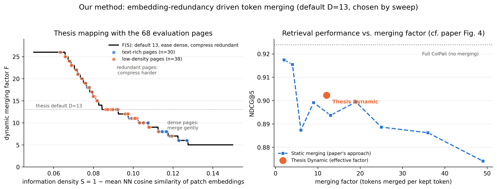
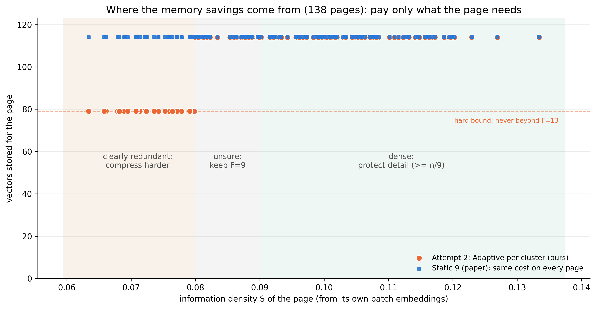
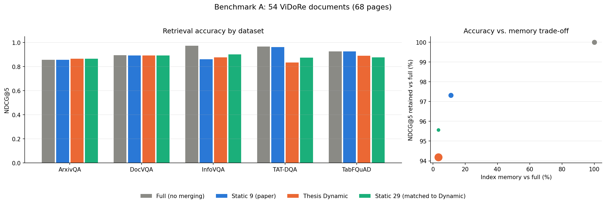
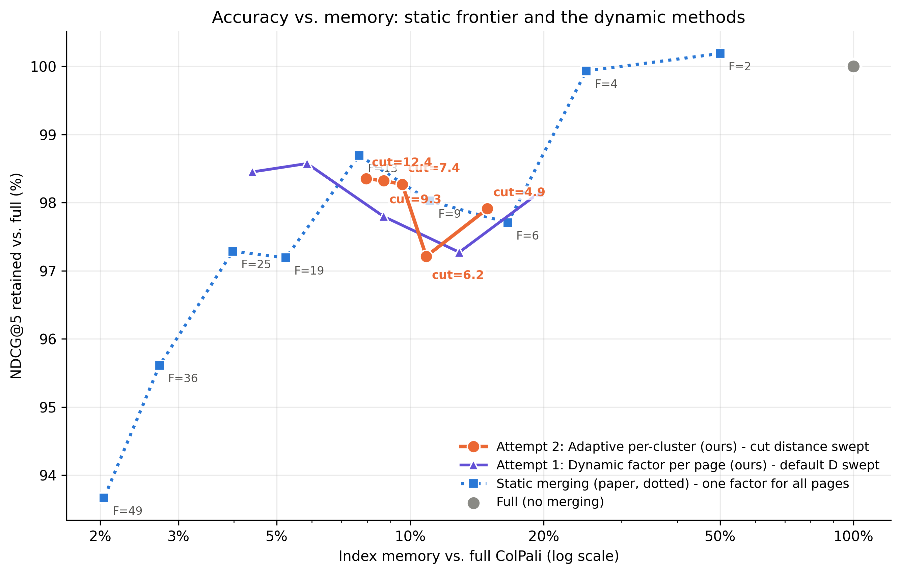
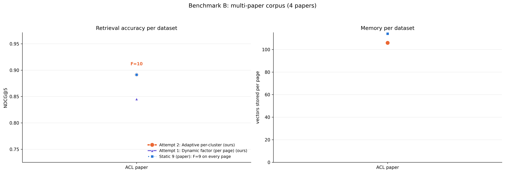

# Dynamic token merging from document analysis — method and results

This is the main write-up of the project: what we built, why each piece looks the way it does,
and what it measures. The code lives in
`Static_vs_Dynamic_Token_Merging_for_Visual_Document_Retrieval.ipynb` (fully commented, one
click to Colab from `README.md`); every number and figure below is regenerated by running it —
nothing is hand-entered.

## 0. Why: the memory problem

ColPali retrieves document pages by embedding **every page as ~1,030 patch vectors** (128-d each).
That multi-vector index is what makes it accurate — and prohibitively large. Light-ColPali
(Ma et al., ACL Findings 2025) shows most of those vectors are redundant and merges them with one
**fixed** factor for the whole collection (their best point: factor 9 ≈ 11% of the memory), noting
that dense text pages lose the most accuracy and leaving adaptive factors as future work.

**Our thesis: the merging factor should come from analysing the document itself.** Identify what
each page can afford — compress redundant pages harder, keep the paper's safe factor where the
page is dense or the analysis is unsure. The payoff is **memory**: an index smaller than even the
paper's best static setting, with accuracy held at the baseline as a constraint.

## 1. The pipeline at a glance

```
PDF document ──render──▶ page image ──ColPali──▶ ~1,030 patch embeddings (128-d each)
                                                    │
                                        [our analysis: ~ms per page]
                                                    │
                              ┌─────────────────────┴─────────────────────┐
                              ▼                                           ▼
                 Attempt 1: per-page factor               Attempt 2: per-cluster granularity
                 (density S → factor F)                   (cut cluster tree by distance,
                                                           safety floors)
                              └─────────────────────┬─────────────────────┘
                                                    ▼
                                     merged vectors stored in the index
                                     (~90% smaller than unmerged)
```

Everything happens **once, offline, at indexing time**. At query time there is no analysis at all —
queries score against a smaller index, so search gets *faster*.

## 2. The analysis signal: `get_density_score(embedding)`

**Question it answers:** *how much distinct information does this page carry?*

```python
S = 1 − mean( nearest-neighbour cosine similarity of the page's patch embeddings )
```

For every one of the ~1,030 patch vectors, find its most similar *other* patch on the same page.
If patches mostly duplicate each other (title slides, posters, white space, repeated texture),
nearest-neighbour similarity is high and **S is low** — the page is *redundant*. If patches are
diverse (dense multi-column text, financial reports), **S is high** — the page is *information-dense*.

Why embeddings and not pixels? We validated both. Pixel heuristics (grayscale variance, edge
density, ink coverage) rank text-rich pages **below** infographics (AUC < 0.5 — they measure visual
busyness, not information). Embedding redundancy ranks them correctly (AUC 0.70), because ColPali's
embeddings already encode *content*, not appearance.

**Cost:** one 1,030×1,030 similarity product ≈ 2–5 ms per page — under 1% of the ~1 s ColPali
forward pass that produced the embeddings.

## 3. Attempt 1: per-page dynamic factor — `get_thesis_factor(S)`

One factor per page, chosen from S around a default:

| Density verdict | Condition | Factor |
|---|---|---|
| **Dense** — protect detail | S > 0.090 | eased from the default toward ~default/2 (e.g. 13 → 5) |
| **Unsure** — don't gamble | 0.080 ≤ S ≤ 0.090 | the default (13) |
| **Clearly redundant** — harvest memory | S < 0.080 | compressed toward 2×default (e.g. 13 → 26) |

Design decisions worth knowing:

- **The default (13) was not hand-picked** — Section 4b of the notebook sweeps it and plots the full
  accuracy-vs-memory curve; 13 is where the curve beats the static baseline on both axes.
- **The "unsure band" exists because of a measured failure:** TabFQuAD table pages sit at S ≈ 0.084.
  They *look* redundant (repeated table cells) but the cells carry distinct numbers; compressing
  them cost accuracy for almost no memory (they are a small share of the corpus). Rule: compression
  must be earned by a *clear* redundancy verdict; uncertainty defaults to the safe factor.
- **Known limitation (kept honestly in the write-up):** any per-page verdict can misidentify a page,
  and then the *whole page* pays. That motivates Attempt 2.



*Left: the S→F mapping with every evaluation page plotted (page types in teal/pink — blue is
reserved for the paper's static baseline throughout). Right: where our operating point lands on
the paper's own accuracy-vs-factor view (cf. their Fig. 4).*

## 4. Attempt 2: adaptive per-cluster merging — `thesis_pool(embedding)`

Instead of one factor per page, let **each region of the page choose its own granularity**:

1. Build the Ward cluster tree over the page's patch embeddings — *the identical tree the official
   Light-ColPali pooler already builds*, so this step adds nothing over the paper's own pipeline.
2. Cut the tree at a merge **distance** (9.3, swept in Section 4b) instead of at a fixed cluster
   *count*. Patches closer than the cut merge into one vector; patches farther apart stay separate.
   Redundant regions collapse to a handful of vectors; dense text regions keep many.
3. **Safety floors** ("keep the paper's factor where needed *or unsure*"): any page the density
   analysis does **not** judge clearly redundant (S ≥ 0.080) is guaranteed at least n/9 vectors —
   it is never merged harder than the paper's own operating point (factor 9). And even a page the
   analysis *is* confident about is never merged harder than **factor 13** (≥ n/13 vectors), so
   one wrong verdict has strictly bounded cost — it can never erase a page.

This is the design's accuracy guarantee: a page the identifier cannot confidently classify keeps the
original merging factor, and no page anywhere is compressed beyond a bounded factor, so
misidentification can cost **savings**, never **accuracy**. (Example: TabFQuAD's repetitive French
tables look redundant to every signal we tested — pixel statistics, embedding redundancy, cross-page
similarity, post-merge fidelity — but their repeated cells carry distinct numbers. Under the floors
their unsure pages stay at factor 9 and their few confidently-flagged pages stop at factor 13;
measured accuracy matches the static baseline exactly while still storing fewer vectors.)
A misjudged *cluster* within a compressed page costs one region, not the page.

## 5. Scoring and evaluation (shared by every method)

- **`pool_page(embedding, factor)`** — the official `HierarchicalTokenPooler` from the paper
  authors' repo (illuin-tech/colpali). Static baselines use it unmodified, so "Static 9" in our
  tables is a faithful reproduction of Light-ColPali's merging, not a reimplementation.
- **`maxsim_matrix(q_embs, d_embs)`** — ColPali's late interaction: each query token takes its best
  match among the page's stored vectors; the sum over query tokens is the page score (paper, §3).
- **`retrieval_metrics(...)`** — ranks the correct page among **all** pages in the corpus and
  reports NDCG@5 / Recall@1 / MRR. The corpus mixes all documents, including multi-page and huge
  (20–25 page) documents, so a method that blurs the differences between sibling pages is punished.
- **`run_benchmark(...)`** — evaluates Full / Static 9 / Attempt 1 / Attempt 2 on the *same*
  embeddings (one model run for everyone), and reports per-dataset accuracy, per-page factors,
  tokens stored and index size.

## 6. Results

<!-- AUTO-RESULTS:BEGIN (regenerated by the notebook - do not edit by hand) -->

*Corpus A: 138 pages from 5 ViDoRe datasets, one real query per page. Metric: NDCG@5 (higher = correct page ranked nearer the top). Model: ColPali v1.2, training-free.*

**The result is MEMORY. The same 138-page corpus that costs full ColPali 34.7 MB is stored in 3.60 MB (**90% smaller, 10x less memory**), 6% below even the paper's best static setting (3.84 MB) - by analysing each document and compressing only where the content allows it. Accuracy is the constraint, not the goal: it stays at the baseline's level.**

## Headline numbers (Benchmark A)

| Method | Memory | Tokens/page | NDCG@5 | Retained |
|---|---|---|---|---|
| Full (no merging) | 100.0% | 1,030 | 0.837 | 100.0% |
| Static 9 (paper) | 11.1% | 114 | 0.820 | 98.0% |
| Attempt 1: Dynamic factor (per page) | 8.7% | 90 | 0.818 | 97.8% |
| Attempt 2: Adaptive per-cluster | 10.4% | 107 | 0.823 | 98.4% |

## Memory savings - the core result

- **Attempt 1 (per-page dynamic factor):** stores 90 vectors/page instead of 1,030 - the index shrinks from 34.7 MB to 3.02 MB (**91% smaller than full ColPali, a 11x reduction**) and **21% smaller than the paper's Static 9** - while retaining 97.8% of retrieval accuracy.
- **Attempt 2 (adaptive per-cluster):** stores 107 vectors/page instead of 1,030 - the index shrinks from 34.7 MB to 3.60 MB (**90% smaller than full ColPali, a 10x reduction**) and **6% smaller than the paper's Static 9** - while retaining 98.4% of retrieval accuracy.

For reference, Static 9 needs 3.84 MB for 98.0% retained accuracy: both our methods save memory beyond the paper's operating point without giving up accuracy.

### What this means at scale

- **Per 1,000,000 pages:** full ColPali needs **246 GB** of index; ours needs **25 GB**. That is 220 GB saved - the difference between a cluster and a single machine.
- **Where the savings come from:** on the 28 pages the analysis flags as clearly redundant, we store **31% less than Static 9** - and the per-dataset accuracy check below shows no dataset pays for it. On a redundancy-heavy workload (slide decks, posters, scans) the gap over the static method grows with the share of such pages; on this deliberately mixed corpus most pages are dense or unsure, where matching the paper's factor is the *correct* decision.
- **Query time:** zero added work - the analysis runs once at indexing; queries score a smaller index, so retrieval gets strictly faster.


**Attempt 1 (per-page dynamic factor) vs Static 9:** -2.4 points of memory with -0.002 NDCG@5 (within noise).


**Attempt 2 (cluster tree cut by distance) - SEPARATE RESULT vs Static 9:** -0.7 points of memory with +0.003 NDCG@5 (a gain).

Attempt 1's weak spot is per-page misidentification (e.g. visually repetitive tables judged compressible); Attempt 2 removes the per-page verdict - each patch cluster merges at its own granularity, so a wrong call can cost at most one region.

**Total index for these 138 pages:** full ColPali 34.7 MB -> Dynamic 3.60 MB (a 90% memory saving) while retaining 98.4% of accuracy; Static 9 needs 3.84 MB for 98.0%.

## Accuracy check: the savings cost nothing (per dataset, Attempt 2 - Static 9)

| Dataset | Static 9 | Dynamic | Delta | Mean F chosen | Reading |
|---|---|---|---|---|---|
| ArxivQA | 0.857 | 0.857 | +0.000 | 11.3 | tie: merging choice made no measurable difference |
| DocVQA | 0.707 | 0.716 | +0.010 | 10.1 | gain: easing to F=10 recovered accuracy here |
| InfoVQA | 0.850 | 0.852 | +0.001 | 9.5 | tie: merging choice made no measurable difference |
| TAT-DQA | 0.869 | 0.869 | +0.000 | 9.0 | tie: merging choice made no measurable difference |
| TabFQuAD | 0.926 | 0.926 | +0.000 | 11.0 | tie: merging choice made no measurable difference |

Hardest dataset for merging overall: **InfoVQA** (Dynamic 0.852 vs Full 0.919).

## Benchmark B (multi-paper corpus, 8 queries - qualitative only)

Attempt 2: 0.891 at 11.0% memory; Attempt 1: 0.845 at 12.3%; Static 9: 0.891 at 11.1%.

## Caveats

- Training-free setting: the paper's 97.8% at factor 9 used fine-tuning; compare methods with each other.
- With ~10 queries per dataset, differences under ~0.02 NDCG@5 are within noise.
- Density thresholds were calibrated once on this corpus (see Section 3).

<!-- AUTO-RESULTS:END -->

### The figures



*The mechanism in one picture: every page plotted by its density score S against the vectors it
stores. Static 9 (blue) pays ~114 vectors for every page regardless of content; ours (orange) drops
to the F=13 bound exactly on the pages the analysis is confident are redundant, and matches the
paper everywhere it is dense or unsure — a blue square inside an orange marker is a tie.*



*Per-dataset view. Blue dotted = the paper's Static 9 (always F=9). Our lines: orange = Attempt 2,
violet = Attempt 1; the F labels are the mean factor our analysis chose for that dataset. Left:
accuracy — our lines sit on or above the dotted baseline. Right: the memory actually stored —
our lines sit below the baseline wherever the documents allow it.*



*The whole trade-off at once: the paper's static sweep (blue) against both of our methods swept
over their own parameter. Up and to the left is better.*



*Case study: finding pages of one target paper among four visually similar research papers
(59 pages, 8 queries). Left: where each method lands on accuracy vs. memory. Right: vectors
stored per page of each paper.*

## 7. Efficiency of the identification algorithm

| Step | Cost per page | Notes |
|---|---|---|
| ColPali forward pass | ~1 s (GPU) | required by every method, including the paper's |
| Density analysis (S) | ~2–5 ms | one matrix product; <1% overhead |
| Attempt 1 factor choice | ~0 | a two-branch formula |
| Attempt 2 tree + cut | ~0.12 s | same tree the paper's pooler builds anyway |
| Query time | **lower than baseline** | no analysis at search time; smaller index to score |

## 8. Reproducing

Run the notebook top to bottom (see `README.md`). Every number in this document's results section
and in `results/` — tables, charts, `RESULTS.md` — is regenerated from scratch by the run.
